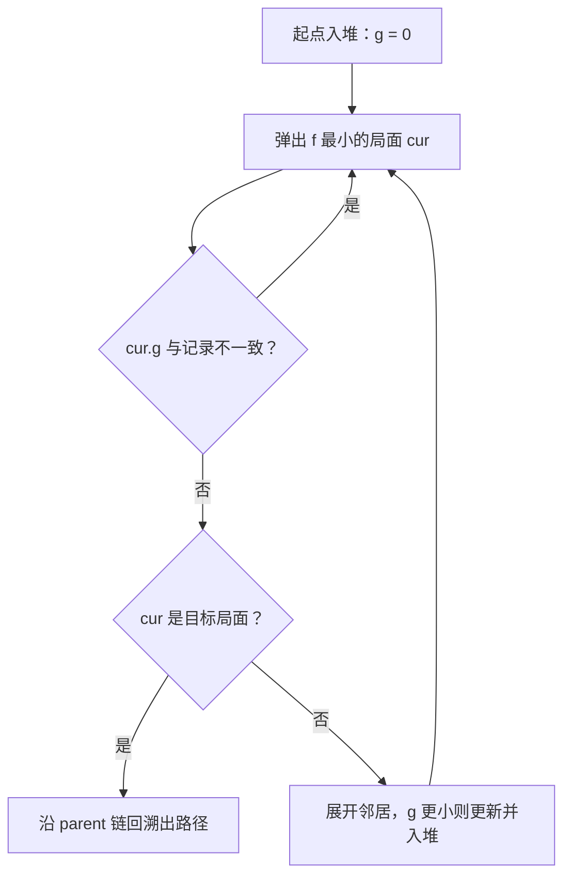

# 数字华容道

规则一句话：点击与空格同行或同列的方块把它滑过去，**把数字恢复成从左到右、从上到下递增的顺序**。3×3 练手，4×4 才是经典。

<ClientOnly>
<SlidingPuzzle />
</ClientOnly>

## 评分标准

| 评价 | 条件 | 称号 |
| ---- | ---- | ---- |
| S | 步数 ≤ A* 的解（3×3 为最优解） | A* 都挑不出毛病 |
| A | 超出参考解 25% 以内 | 稳 |
| B | 超出参考解 60% 以内 | 还能再紧凑点 |
| C | 更多 | 完成就是胜利 |

「参考解」由 A* 搜索算出：3×3 直接给最优解，4×4 用加权搜索换速度，给一个接近最优的步数作基准。

## 背后的算法：A\* 搜索

游戏里那个「🤖 A* 求解演示」不是预先录好的，是**当场跑 A\* 搜出来的**。下面按「为什么这么建模 → 代码怎么写 → 为什么能保证最优」的顺序拆开讲。

### 一、把华容道看成一张图

每一次滑动就是图上的一条边，每个局面就是一个**节点**：

- **3×3**：可达局面 $\frac{9!}{2} = 181\,440$ 种，暴力 BFS 都能秒过
- **4×4**：$\frac{16!}{2} \approx 1.05 \times 10^{13}$ 种，BFS 每层就有上百万节点，内存直接爆掉

所以不能盲目地一层层搜，得让搜索**朝着目标方向偏**——这就是 A\* 存在的意义：它给每个待扩展的局面打一个分，永远先扩展「看起来最有希望」的那个。

### 二、状态怎么存、邻居怎么找

棋盘用一维数组表示，`0` 代表空格。目标状态是 `[1,2,…,n²-1,0]`，判断是否完成只需要一行：

```ts
// 目标状态：[1, 2, …, n²-1, 0]
function solved(n: number) {
  return Array.from({ length: n * n }, (_, i) => (i + 1) % (n * n));
}

function isSolved(arr: number[]) {
  return arr.every((v, i) => v === (i + 1) % arr.length);
}
```

因为每次只能滑动空格旁边的一块，所以「邻居」只由空格的位置决定，最多 4 个：

```ts
// i 是空格的下标，返回所有可以滑进空格的格子下标
function neighbors(i: number, n: number) {
  const x = i % n;          // 列
  const y = (i / n) | 0;    // 行
  const out: number[] = [];
  if (y > 0) out.push(i - n);      // 上
  if (x < n - 1) out.push(i + 1);  // 右
  if (y < n - 1) out.push(i + n);  // 下
  if (x > 0) out.push(i - 1);      // 左
  return out;
}
```

搜索时用 `arr.join(",")` 当 key（比如 `"1,2,3,4,5,6,7,0,8"`）。字符串做哈希虽然有点浪费内存，但胜在简单、绝对不会有碰撞，对 3×3、4×4 这个规模完全够用。想要更快可以换成 BigInt 位压缩或预计算置换表。

### 三、估价函数 f = g + h

$$f(n) = g(n) + h(n)$$

- $g(n)$：从起点走到当前局面**已经花了多少步**
- $h(n)$：从当前局面到目标**还差多少步的估计值**

A\* 的性质完全取决于 $h$ 选得好不好。这里用**曼哈顿距离**：每个数字当前位置到它目标位置的行差 + 列差，全部加起来（空格不参与，因为它没有「家」）：

$$h = \sum_{i=1}^{n^2-1} \Big( |x_i - x_i^*| + |y_i - y_i^*| \Big)$$

```ts
function manhattan(arr: number[], n: number) {
  let h = 0;
  for (let i = 0; i < arr.length; i++) {
    const v = arr[i];
    if (v === 0) continue;          // 空格不贡献距离
    const goal = v - 1;             // 数字 v 的目标下标
    h += Math.abs((i % n) - (goal % n))               // 列差
       + Math.abs(((i / n) | 0) - ((goal / n) | 0));  // 行差
  }
  return h;
}
```

**为什么它「可采纳」（never overestimate）？** 一次滑动只会让一个数字移动一格，所以每走一步，总曼哈顿距离最多减少 1。反过来说，剩下要走的最少步数一定 **≥** 当前的曼哈顿距离。$h$ 永远不会高估真实代价，A\* 才敢放心地用它剪枝——这也是它能保证**最优解**的前提。

对比一下更偷懒的「错位块数」启发：同样可采纳，但一个数字要挪 5 格它也只算 1，下界太松，A\* 会被大量「看起来不错其实很远」的局面带偏，展开节点数可能多出几倍。曼哈顿距离更紧，效率高得多。

### 四、主循环



这里有个细节：用了**二叉小顶堆**存 open 表，而不是每次对数组排序（`O(n log n)` 排一次不如堆的 `O(log n)` 插入/弹出）：

```ts
// 只按 f 排序的二叉小顶堆
class Heap {
  a: { f: number; g: number; key: string }[] = [];

  push(x: { f: number; g: number; key: string }) {
    const a = this.a;
    a.push(x);
    let i = a.length - 1;
    while (i > 0) {                    // 上浮
      const p = (i - 1) >> 1;
      if (a[p].f <= a[i].f) break;
      [a[p], a[i]] = [a[i], a[p]];
      i = p;
    }
  }

  pop() {
    const a = this.a;
    const top = a[0];
    const last = a.pop()!;
    if (a.length) {
      a[0] = last;
      let i = 0;
      for (;;) {                       // 下沉
        const l = 2 * i + 1;
        const r = l + 1;
        let m = i;
        if (l < a.length && a[l].f < a[m].f) m = l;
        if (r < a.length && a[r].f < a[m].f) m = r;
        if (m === i) break;
        [a[m], a[i]] = [a[i], a[m]];
        i = m;
      }
    }
    return top;
  }

  get size() {
    return this.a.length;
  }
}
```

然后是 A\* 主体，注释标了每一段的用意：

```ts
// 返回「空格依次要滑到的下标」序列，失败返回 null
function aStar(start: number[], n: number): number[] | null {
  const goalKey = solved(n).join(",");
  const w = n === 3 ? 1 : 2.5;      // 4×4 用加权 A* 换速度，见下一节
  const CAP = 500000;               // 展开上限，防止极端局面卡死页面
  const startKey = start.join(",");
  if (startKey === goalKey) return [];

  const open = new Heap();
  open.push({ f: w * manhattan(start, n), g: 0, key: startKey });

  // 已知最优 g 值，同时充当「访问过」标记
  const gScore = new Map<string, number>([[startKey, 0]]);
  // 记录每个局面是从哪来的，以及空格移动到了哪个格子
  const parent = new Map<string, { key: string; blank: number }>();

  let expanded = 0;

  while (open.size) {
    const cur = open.pop();

    // 惰性删除：同一个局面可能被以不同的 g 压入多次，
    // 只有当堆里这份的 g 和最新记录一致时才是有效项
    if (cur.g !== gScore.get(cur.key)) continue;

    if (cur.key === goalKey) {
      const path: number[] = [];
      let k = cur.key;
      while (k !== startKey) {
        const p = parent.get(k)!;
        path.unshift(p.blank);
        k = p.key;
      }
      return path;                  // 逆序回溯 → 正序路径
    }

    if (++expanded > CAP) return null;

    const arr = cur.key.split(",").map(Number);
    const blank = arr.indexOf(0);
    const g2 = cur.g + 1;

    for (const nb of neighbors(blank, n)) {
      // 直接在原数组上滑一下，算完 key 再滑回来，省掉每次拷贝整个数组
      arr[blank] = arr[nb];
      arr[nb] = 0;
      const key2 = arr.join(",");

      if (g2 < (gScore.get(key2) ?? Infinity)) {   // 找到更短的到达方式
        gScore.set(key2, g2);
        parent.set(key2, { key: cur.key, blank: nb });
        open.push({ f: g2 + w * manhattan(arr, n), g: g2, key: key2 });
      }

      arr[nb] = arr[blank];   // 撤销这次虚拟滑动
      arr[blank] = 0;
    }
  }
  return null;
}
```

几个容易踩的坑，这份实现里都处理了：

| 坑 | 处理方式 |
| ---- | ---- |
| 同一局面被反复压入堆 | 弹出时比对 `cur.g` 与 `gScore`，不一致就丢弃（惰性删除） |
| 每个邻居都拷贝一次数组 | 原地滑一下、算完再滑回去，`O(1)` 额外空间 |
| 死循环 | `gScore` 只记录更优的 `g`，加上 `CAP` 展开上限兜底 |
| 4×4 搜不动 | 加权启发（下一节），搜不到时退回曼哈顿距离 ×2 当参考值 |

### 五、路径怎么还原出来

`parent` 里存的是「到达该局面的前一个局面 + 这次空格滑到了哪个格子」。搜到目标后从终点顺着链往回走，每走一步就把 `blank` 插到路径**最前面**（`unshift`），最后得到的正好是**从起点开始、每次该点哪个格子**的顺序——直接拿去驱动演示动画。

这也解释了演示为什么能一格一格地动：路径里的每个值是「要滑进空格的方块下标」，和玩家点击方块的逻辑完全一致。

### 六、3×3 最优、4×4 只给「参考解」

3×3 用纯 A\*（$w = 1$），找到的一定是最优解。所以评分里 S 档的判定是**步数 ≤ A\* 解**——意思是「你已经做到了理论极限」。

4×4 就不一样了：状态空间大了约 8 个数量级，纯 A\* 可能展开几百万节点、把页面卡死。于是把启发乘一个系数 $w = 2.5$：

$$f(n) = g(n) + 2.5 \cdot h(n)$$

这叫**加权 A\***（weighted A\*）。$h$ 被放大后高估了剩余代价，搜索会更贪心地往目标冲，展开的节点数大幅下降，代价是不再保证最优。理论上有界：解的长度不超过 $w \times$ 最优解；实测下 4×4 一般也就多个几步到十几步，作为「参考解」完全够用。

万一 4×4 搜到上限还没找到（极端局面），代码里会退一步：

```ts
const plan = aStar(cells.value, n.value);
par.value = plan ? plan.length : manhattan(cells.value, n.value) * 2;
```

即用「曼哈顿距离 ×2」当经验基准，保证 HUD 上永远有参考值。

### 七、还能怎么优化

如果想让 4×4 也跑出**真·最优解**，常用这几招，按性价比排序：

1. **IDA\***（迭代加深 A\*）：把堆换成递归 + 深度阈值，内存从「指数级」降到「线性」，是 15 数码经典解法
2. **线性冲突（linear conflict）**：两个数字在同一行/列但顺序反了，曼哈顿距离会低估，各加 2 修正后可采纳性不变、剪枝更狠
3. **模式数据库（PDB）**：预计算部分子问题（比如只含 1~8 号块）的精确距离存表，查表当启发，速度能再快一个数量级
4. **双端 BFS**：从起点和目标同时搜，相遇即止，适合求**最短**路径的 4×4

::: tip 为什么随机打乱一定可解？
打乱不是随机排列，而是从复原状态出发随机走几百步「合法移动」。每一步都保持可解性，所以局面永远可解——这也是华容道和随机洗牌的 15 数码最重要的区别：随便乱排的 15 数码有一半是无解的（逆序数奇偶性不对）。
:::
